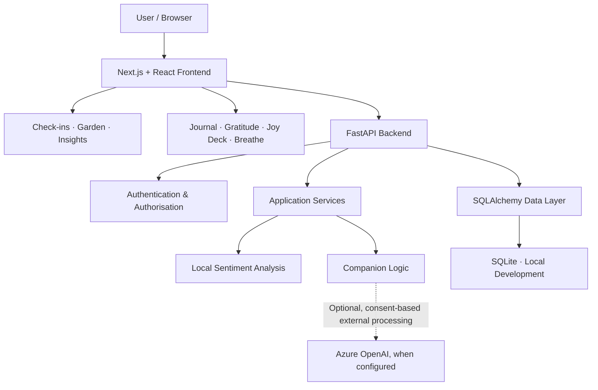
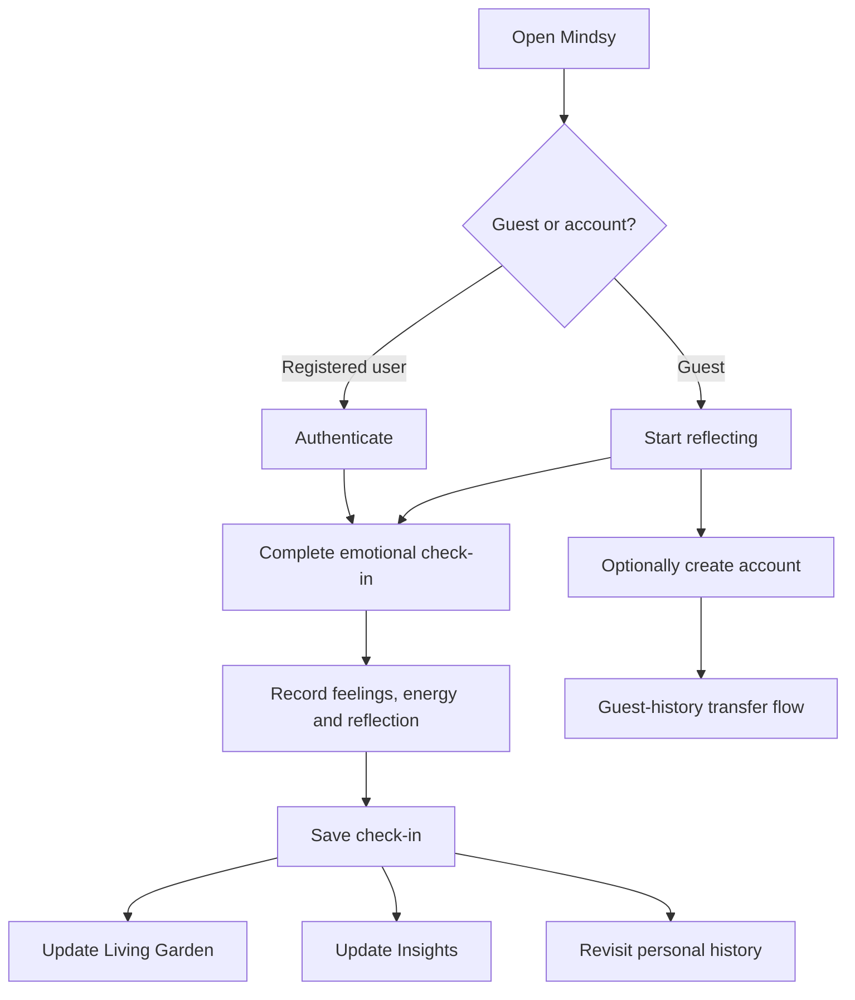

# Mindsy 🌷

### A softer place to check in.

**Feel what you feel. Put it into words. Watch it grow.**

Mindsy is a visual mental-wellness check-in and reflection application built around a simple idea: emotional well-being deserves a space that feels gentle, personal, and free from judgement.

Through guided emotional check-ins, a living botanical garden, personal journaling, mood insights, and small restorative experiences, Mindsy turns everyday reflection into something tangible.

It is not about chasing perfect days. It is about making space for the days you actually have.


<p align="center">
  **A softer place to understand your own emotional landscape.**
</p>

---

## Contents

- [The idea behind Mindsy](#the-idea-behind-mindsy)
- [What makes Mindsy different](#what-makes-mindsy-different)
- [Explore the experience](#explore-the-experience)
- [The Living Garden](#the-living-garden)
- [Insights without judgement](#insights-without-judgement)
- [Technology and architecture](#technology-and-architecture)
- [How Mindsy works](#how-mindsy-works)
- [Privacy and security](#privacy-and-security)
- [Project structure](#project-structure)
- [Getting started](#getting-started)
- [Configuration](#configuration)
- [Testing](#testing)
- [Deployment status](#deployment-status)
- [Roadmap](#roadmap)
- [Contributing](#contributing)
- [Licence](#licence)

---

## The idea behind Mindsy

Emotions are not linear. Some days feel light. Some feel complicated. Some are a mixture that does not fit neatly into one word.

Yet many digital wellness experiences reduce those moments to scores, streaks, or rigid productivity metrics.

Mindsy takes a different approach.

It gives users a calm space to:

- Acknowledge what they are feeling.
- Reflect without pressure.
- Recognise emotional patterns over time.
- Keep a personal record of their experiences.
- Find small, approachable ways to pause and reset.

The experience is intentionally built around three principles:

| Principle | What it means |
|---|---|
| **Reflection over measurement** | Emotional experiences are recorded, not graded. |
| **Personal history over performance** | Check-ins become a visual record rather than a competition. |
| **Gentleness over judgement** | The application describes patterns without pretending to diagnose the person behind them. |

## What makes Mindsy different

### 01. A check-in becomes something you can see

Most mood trackers leave you with a list or a graph.

Mindsy gives every check-in a place in your Living Garden. Each plant represents an individual moment, creating a visual relationship between emotional history and personal reflection.

### 02. Start without an account

Mindsy follows a guest-first approach.

Users can begin exploring the application without being forced through registration. An account provides a way to preserve their history beyond the current browser profile, with a guest-history transfer experience.

### 03. Patterns, not verdicts

Insights are intended to help users notice what their own check-ins contain.

Mindsy does not turn those observations into diagnoses or clinical labels.

### 04. More than a mood tracker

Check-ins sit alongside journaling, gratitude, breathing exercises, reflection prompts, and companion support.

The result is a collection of small experiences rather than one rigid daily task.

---

## Explore the experience

### 01 — Begin with how you feel

Mindsy's emotional check-in is organised into five steps.


| Step | Experience |
|---|---|
| **Feelings** | Select multiple emotions that reflect the moment. |
| **Energy** | Record your available energy. |
| **Reflection** | Add an optional personal note. |
| **Tags** | Give the experience additional context. |
| **Plant** | See the moment become part of your garden. |

There are no scores to achieve and no requirement to write a particular amount.

### 02 — Give the experience a place to grow


Every check-in becomes part of a visual botanical space.

Plants are derived from the emotional information recorded in the check-in. Their positions and identities are designed to remain stable, so revisiting the garden does not randomly rearrange personal history.

### 03 — Notice what your history contains


The Insights experience brings together summaries of recorded check-ins, including mood distribution, energy patterns, and activity over time.

The purpose is awareness, not judgement.

### 04 — Make room for longer thoughts


The journal provides a separate space for longer reflections, with entry titles, optional feeling labels, search, and editing controls.

### 05 — Keep the experience personal


Guest mode makes it possible to begin immediately. Registration is available when the user wants a longer-term account and a way to transfer their guest history.

---

## The Living Garden

### Your feelings, growing.

The Living Garden is Mindsy's signature feature and its central visual metaphor.

Rather than treating emotional history as rows in a table, the garden gives each check-in a visual identity.


Its design follows a few simple rules:

- Each check-in corresponds to a plant.
- The dominant feeling influences the plant's visual identity.
- New check-ins begin as seedlings.
- Plants develop as time passes.
- Multiple feelings can produce a mixed blossom.
- A plant can be selected to revisit its source check-in.
- Plant placement and identity are designed to remain stable.

The garden is not a reward system. It does not decide whether a person has had a good or bad day.

It simply gives their experiences somewhere to belong.


---

## Insights without judgement

### Patterns, not verdicts.

Mindsy's Insights experience focuses on descriptive summaries of information users have entered.


The visible experience includes:

- Check-in summaries.
- Mood distribution.
- Energy distribution.
- Recent activity across a fourteen-day window.
- Frequently recorded feelings.
- Current streak information.

These are descriptive observations derived from check-in history, not medical assessments.

Empty days are not failures. Different emotions are not performance indicators.

---

## Everything else in Mindsy

Mindsy brings together several complementary experiences.


| Experience | Description |
|---|---|
| **Journal** | A private space for longer thoughts, with search and editing. |
| **Joy Deck** | Small, practical prompts for moments when you need somewhere to begin. |
| **Breathe** | A guided breathing experience with reduced-motion considerations. |
| **Mood Weather** | A descriptive view of the emotional atmosphere reflected in recent check-ins. |
| **Gratitude Wall** | A collection of small positive moments on revisit-able notes. |
| **Companion** | A supportive reflection experience with transparent limitations and no claim to provide diagnosis. |

---

## Technology and architecture

Mindsy is structured as a full-stack web application, separating its user-facing experience from its backend API and persistence layer.

### Technology stack

The following technologies are identified in the project's existing technical documentation. Exact versions should be confirmed against the committed dependency manifests and lockfiles.

| Layer | Technology | Responsibility |
|---|---|---|
| Frontend framework | **Next.js 15** | Application routing and frontend delivery |
| UI library | **React 19** | Component-based interface |
| Language | **TypeScript** | Frontend type safety |
| Styling | **Tailwind CSS** | Utility-based styling |
| Motion | **Framer Motion** | Interface animations and transitions |
| Icons | **Lucide React** | Interface iconography |
| Backend framework | **FastAPI** | Backend API and request handling |
| Backend language | **Python 3.11+** | Application and service logic |
| ORM | **SQLAlchemy 2** | Database models and persistence operations |
| Validation | **Pydantic 2** | Request and response validation |
| API server | **Uvicorn** | ASGI application serving |
| Authentication | **JWT / PyJWT** | Token-based authentication |
| Local database | **SQLite** | Local development persistence |
| Sentiment analysis | **VADER** | Local sentiment scoring, where enabled |
| Optional language integration | **Azure OpenAI** | Opt-in companion response capability, when configured |
| Testing | **pytest** | Backend testing |
| Development | **Git, npm, Python virtual environments** | Source control and development workflow |

Optional integrations are not required for the core local application unless the actual configuration says otherwise.

### High-level architecture



Production storage and hosting are deployment-specific. A production database adapter must be implemented and verified for the selected host before it is described as operational.

### Architectural considerations

Mindsy's architecture separates:

- Presentation and navigation.
- API communication.
- Authentication and user authorisation.
- Application-specific services.
- Database models and persistence.
- Optional external integrations.

This separation makes it possible to develop the frontend and backend independently while maintaining defined API contracts.

---

## How Mindsy works

The user journey is designed to be straightforward.



The purpose is to make reflection accessible immediately, while providing an account pathway for users who want to preserve their history beyond their current browser.

---

## Privacy and security

Mental-wellness information deserves careful handling.

Mindsy's security and privacy design includes mechanisms for authentication, user-specific access, and environment-based configuration.

The implementation should be evaluated against the actual backend source code before relying on any particular security guarantee.

The documented security considerations include:

- Password hashing rather than plaintext password storage.
- Token-based authentication.
- Access-token validation and expiry.
- Server-side token revocation where implemented.
- User ownership checks for protected resources.
- Validated API request models.
- Environment-based configuration of sensitive settings.
- Restricted production CORS origins.
- Separation of private backend credentials from frontend code.

### Optional external processing

Mindsy's Companion has an optional Azure OpenAI integration.

External processing should only be enabled through the application's explicit consent mechanism and applicable configuration. The local reflection experience should not be described as requiring an external model unless the actual implementation establishes that dependency.

### Important limitations

Mindsy is a personal wellness and reflection application.

It is not a diagnostic tool, a medical device, a crisis-response service, or a replacement for professional mental-health support.

Do not use it as a substitute for qualified care.

---

## Project structure

The following is an abbreviated view of the application's architecture. The repository itself is authoritative for the complete structure.

```text
mindsy/
│
├── frontend/
│   ├── src/
│   │   ├── app/
│   │   │   ├── checkin/
│   │   │   ├── garden/
│   │   │   ├── insights/
│   │   │   ├── journal/
│   │   │   ├── login/
│   │   │   ├── signup/
│   │   │   └── ...
│   │   ├── components/
│   │   ├── lib/
│   │   └── styles/
│   │
│   ├── package.json
│   └── next.config.js
│
├── backend/
│   ├── app/
│   │   ├── main.py
│   │   ├── config.py
│   │   ├── database.py
│   │   ├── deps.py
│   │   ├── models/
│   │   ├── routes/
│   │   ├── schemas/
│   │   └── services/
│   │
│   ├── tests/
│   └── requirements.txt
│
├── docs/
│   └── screenshots/
│
├── .gitignore
├── CHANGELOG.md
├── LICENSE
└── README.md
```

---

## Getting started

### Prerequisites

- Git.
- Node.js compatible with the frontend's declared requirements.
- npm.
- Python 3.11 or the version supported by the backend dependencies.

Check the project's package manifests and dependency files for exact versions before installation.

### 1. Clone the repository

```bash
git clone https://github.com/n0tify/mindsy-mental-health-check-in-agent.git

cd mindsy-mental-health-check-in-agent
```

### 2. Set up the backend

From the repository root:

**Windows PowerShell**

```powershell
cd backend

py -3.11 -m venv .venv

.\.venv\Scripts\Activate.ps1

python -m pip install -r requirements.txt
```

Start the API server:

```powershell
python -m uvicorn app.main:app --reload --host 127.0.0.1 --port 8010
```

When enabled, backend API documentation is available at:

`http://127.0.0.1:8010/docs`

### 3. Set up the frontend

Open a second terminal from the repository root:

```powershell
cd frontend

npm install

npm run dev
```

Open:

`http://localhost:3000`

### 4. Run both services

The local development environment uses separate processes:

| Service | Local address |
|---|---|
| Frontend | `http://localhost:3000` |
| Backend | `http://127.0.0.1:8010` |
| API documentation | `http://127.0.0.1:8010/docs` |

Frontend and backend configuration must point to one another correctly.

### Environment configuration

Use the actual environment-variable names defined by the backend configuration and frontend application.

Keep private settings server-side.

Never commit:

- JWT signing secrets.
- API keys.
- Passwords.
- Personal database files.
- Private environment files.
- Production credentials.

Use example values only in committed environment templates.

---

## Testing and quality

Mindsy's tests and quality checks should be run from the relevant project directories.

### Backend

```powershell
cd backend

python -m pytest tests/ -v
```

### Frontend

Use the scripts declared in `frontend/package.json`, including the configured lint, type-check and production-build commands.

### What should be verified

A successful build is only one part of application verification.

The important user journeys include:

- Guest access.
- Check-in creation.
- Garden updates.
- Insights generation.
- Journal creation and editing.
- Registration.
- Login and logout.
- Guest-history transfer.
- User-specific data access.
- Data persistence after reload.

Do not claim production readiness or complete test coverage without actual test evidence.

---

## Deployment status

Mindsy has a Next.js frontend and a FastAPI backend. Its local development database is SQLite.

The intended production hosting arrangement is subject to runtime and database compatibility verification.

In particular, Cloudflare D1 must not be described as a conventional SQLAlchemy SQLite connection. Production access requires a genuine supported database integration.

A public deployment should only be described as complete once:

1. The frontend is publicly accessible over HTTPS.
2. The backend is deployed and responding.
3. Persistent production storage works.
4. Authentication works in the deployed environment.
5. Frontend and backend communicate successfully.
6. Core application workflows pass public end-to-end tests.

No public production URL is claimed in this README until these conditions are verified.

---

## Roadmap

The roadmap below distinguishes the existing product experience from future work.

| Area | Direction |
|---|---|
| Emotional reflection | Continue improving the check-in experience |
| Living Garden | Extend visual variety while preserving stable plant identity |
| Insights | Improve the clarity of descriptive emotional summaries |
| Accessibility | Refine keyboard access and reduced-motion behaviour |
| Privacy | Strengthen data ownership and transparent processing choices |
| Authentication | Improve account recovery and verification flows |
| Deployment | Complete and verify persistent production hosting |
| Documentation | Maintain accurate setup, architecture and API references |

The roadmap is directional, not a promise that every item has been implemented.

---

## Contributing

Contributions that improve accessibility, reliability, privacy, security, and the reflection experience are welcome.

1. Fork the repository.
2. Create a focused feature branch.
3. Make a small, clearly scoped change.
4. Run relevant tests and checks.
5. Submit a pull request with an explanation and verification notes.

Mindsy's product philosophy matters in contributions: avoid diagnostic claims, pressure-based streak mechanics, unnecessary personal-data collection, or design changes that compromise the calm and accessible experience.

---

## Licence

See the repository's [`LICENSE`](LICENSE) file for the applicable licence and permissions.

---

<p align="center">
  **Mindsy**<br/>
  *A softer place to check in.*
  <br/><br/>
  Feel what you feel. There's room for it here. 🌷
</p>
