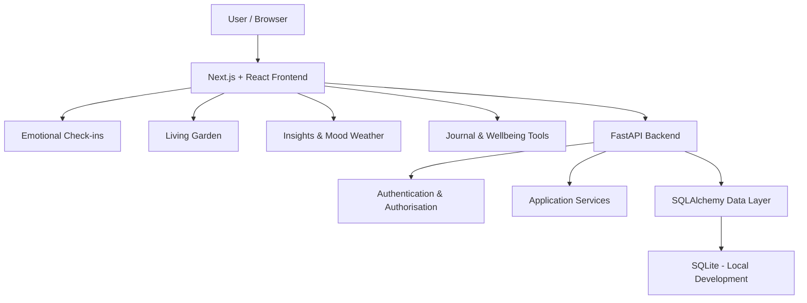
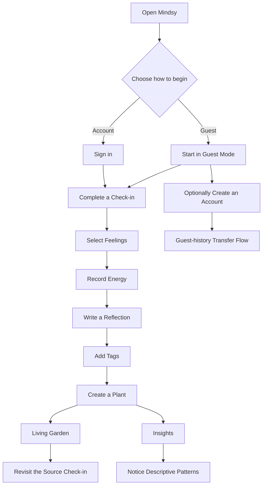

# Mindsy 🌷

<p align="center">
  <strong>A softer place to check in.</strong><br />
  <em>Feel what you feel. Put it into words. Watch it grow.</em>
</p>

<p align="center">
  A thoughtful space for emotional check-ins, personal reflection, and a garden that grows with you.
</p>

<p align="center">
  
</p>

<p align="center">
  <a href="#-the-thinking-behind-mindsy">The idea</a> ·
  <a href="#-explore-mindsy">Features</a> ·
  <a href="#-the-living-garden">Living Garden</a> ·
  <a href="#-technology--architecture">Architecture</a> ·
  <a href="#-getting-started">Get started</a> ·
  <a href="#-privacy--safety">Privacy</a>
</p>

---

## 🌷 The thinking behind Mindsy

Emotions do not arrive in neat categories. Some days feel light, some feel difficult, and some are a mixture of things that are hard to explain.

Yet many digital wellness experiences reduce emotional reflection to scores, streaks, and numbers.

**Mindsy takes a gentler approach.**

It gives people a place to acknowledge what they feel, record what is on their mind, and revisit their experiences through a visual garden.

Rather than asking whether a day was good or bad, Mindsy makes room for the day as it actually happened.

### Built around three ideas

| Principle | How Mindsy approaches it |
|---|---|
| **Reflection, not measurement** | Record feelings without grading them. |
| **Personal history, not performance** | Let each check-in become part of a visual record. |
| **Awareness, not judgement** | Describe patterns without turning them into diagnoses. |

Mindsy is a personal wellness journal and reflection tool. It is not a medical service and does not diagnose or treat mental-health conditions.

## ✨ Explore Mindsy

Mindsy brings together structured emotional reflection and small, approachable wellbeing experiences.

### 01. Emotional check-ins

**Five small steps. No scores. No judgement.**

The guided check-in helps users capture an honest snapshot of how they feel.

<p align="center">
  
</p>

| Step | What happens |
|---|---|
| **Feelings** | Choose as many emotions as fit the moment. |
| **Energy** | Record the energy available to you. |
| **Reflection** | Write a little or a lot, in your own words. |
| **Tags** | Add context to the check-in. |
| **Plant** | Give the experience a place in the Living Garden. |

The first selected feeling influences the flower's visual identity. Multiple feelings can be represented together.

### 02. The Living Garden

**Your feelings, growing.**

Every check-in becomes a plant. Its visual identity comes from the emotional information recorded, connecting a moment of reflection with a place in the garden.

<p align="center">
  
</p>

The garden follows a few distinctive rules:

- Each check-in corresponds to a plant.
- The dominant feeling influences the plant species.
- New plants begin as seedlings and develop over time.
- Three or more feelings can form a mixed blossom.
- Selecting a plant lets the user revisit its source check-in.
- Plant identity and placement are designed to remain stable across refreshes.

The garden is not a reward system. It does not decide whether someone has had a good or bad day.

It simply gives personal experiences somewhere to belong.

### 03. Insights and Mood Weather

**Patterns, not verdicts.**

Mindsy turns check-in history into descriptive summaries that help users notice what their own records contain.

<p align="center">
  
</p>

<p align="center">
  
</p>

The interface presents:

- Check-in summaries.
- Mood distribution.
- Energy distribution.
- Frequently recorded feelings.
- Recent activity over a fourteen-day window.
- Current streak information.

These summaries are descriptive, not diagnostic. Mindsy does not turn emotional patterns into clinical conclusions.

### 04. Journal

**A place for the longer thoughts.**

Check-ins capture a moment. The journal holds the rest: paragraphs, half-formed thoughts, and things worth coming back to.

<p align="center">
  
</p>

The journal interface includes:

- Entry titles.
- Optional feeling labels.
- Longer written reflections.
- Search across entries.
- Editing and deletion controls.

### 05. Guest-first experience

**Begin before you are ready to create an account.**

<p align="center">
  
</p>

Mindsy allows users to begin exploring without mandatory registration.

Guest activity is kept in the current browser profile. An account provides a way to keep personal history beyond that browser, with a guest-history transfer experience.

Guest mode should not be treated as a backup. Clearing browser data or changing browser profiles may make locally stored guest history unavailable.

---

## 🌼 The Living Garden

### More than a mood chart

The Living Garden is Mindsy's signature experience.

Instead of presenting emotional history only as rows, counts, or charts, it gives each check-in a visual identity.

<p align="center">
  
</p>

A happy moment might become a sunflower. A calm one might become lavender. A check-in containing several feelings can grow into a mixed blossom.

Every plant is connected to the check-in that created it, so the garden can also become a way to revisit personal reflections.

**The idea is simple: your experiences do not need to be ranked to be remembered.**

---

## 🌸 Everything else in Mindsy

The wider experience includes several small tools for different kinds of reflection and care.

| Experience | What it offers |
|---|---|
| **Joy Deck** | Small, practical prompts for moments when you need somewhere to begin. |
| **Breathe** | A guided breathing experience with reduced-motion considerations. |
| **Mood Weather** | A descriptive view of the emotional atmosphere reflected in recent check-ins. |
| **Gratitude Wall** | Small good things collected on notes that can be revisited. |
| **Companion** | A supportive reflection experience with transparent limitations and no claim to provide diagnosis. |

These experiences complement the main check-in and journaling flow rather than turning wellness into another task list.

---

## 🧩 Technology & architecture

Mindsy is organised as a full-stack web application, with a separate frontend, backend API, and persistence layer.

### Core technology stack

| Layer | Technology | Role |
|---|---|---|
| Frontend framework | **Next.js** | Web application and routing |
| UI library | **React** | Component-based interface |
| Frontend language | **TypeScript** | Typed frontend development |
| Backend language | **Python** | Backend application logic |
| API framework | **FastAPI** | API endpoints and request handling |
| ORM | **SQLAlchemy** | Database interaction and persistence |
| Local database | **SQLite** | Local development storage |
| Testing | **pytest** | Backend test framework |
| Source control | **Git** | Version control |

The exact dependency versions and additional UI libraries are defined by the repository's package manifests and dependency files. Those files should be treated as authoritative rather than relying on version numbers copied into documentation.

### Application architecture



### Architectural responsibilities

**Frontend**
- Presents the Mindsy experience.
- Handles navigation and user interaction.
- Displays check-ins, garden, insights, journal, and supporting tools.
- Communicates with the backend API.

**Backend**
- Handles application API requests.
- Provides account and authentication operations.
- Applies application and data-access logic.
- Coordinates persistence through the database layer.

**Persistence**
- Uses SQLAlchemy for database interaction.
- Uses SQLite for local development.
- Requires a separately verified production database integration before deployment can be described as production-ready.

The separation allows the interface, API, and persistence layer to be developed and tested independently.

---

## 🔄 How Mindsy works



The central flow is designed to make reflection accessible immediately, while giving users an account pathway when they want to preserve their history beyond the current browser.

---

## 🔐 Privacy & safety

Mental-wellness information deserves careful handling.

Mindsy's account and application architecture includes authentication and user-specific data handling. The exact security guarantees depend on the current backend implementation and production configuration.

Important implementation areas include:

- Server-side password handling.
- Authentication and token validation.
- Session expiry and revocation.
- User ownership checks for protected records.
- Input validation.
- Environment-based secret configuration.
- Restricting production cross-origin requests.
- Keeping private backend credentials out of frontend bundles.

The password-hashing algorithm and legacy-hash compatibility must be confirmed against the current backend security service. The sign-up interface alone is not sufficient evidence for a specific algorithm.

### Guest data

Guest activity is associated with the current browser profile. Users should understand that browser data clearing or profile changes may affect access to guest history.

### Optional external services

Only describe external AI or language-model processing as enabled when the relevant code, configuration, and user-consent flow are present and verified. Do not assume that the core reflection experience requires an external AI provider.

### Important limitation

Mindsy is a wellness journal and reflection application. It is not a medical device, diagnostic system, crisis-response service, or replacement for professional mental-health support.

---

## 📁 Project structure

The following is an abbreviated view of the repository. The actual checked-out source tree is authoritative.

```text
mindsy/
│
├── frontend/
│   ├── app/
│   ├── components/
│   ├── package.json
│   └── ...
│
├── backend/
│   ├── app/
│   │   ├── main.py
│   │   ├── config.py
│   │   ├── database.py
│   │   ├── models/
│   │   ├── routes/
│   │   ├── schemas/
│   │   └── services/
│   │
│   ├── tests/
│   └── ...
│
├── docs/
│
├── CHANGELOG.md
├── LICENSE
└── README.md
```

---

## 🚀 Getting started

### Prerequisites

- Git.
- Node.js compatible with the frontend's declared version.
- npm.
- Python compatible with the backend dependencies.

Check the committed dependency files for exact versions before installing.

### 1. Clone the repository

```bash
git clone https://github.com/n0tify/mindsy-mental-health-check-in-agent.git

cd mindsy-mental-health-check-in-agent
```

### 2. Set up the backend

From the repository root:

**Windows PowerShell**

```powershell
cd backend

py -3.11 -m venv .venv

.\.venv\Scripts\Activate.ps1

python -m pip install -r requirements.txt
```

Start the backend:

```powershell
python -m uvicorn app.main:app --reload --host 127.0.0.1 --port 8010
```

When enabled, the API documentation is available at:

`http://127.0.0.1:8010/docs`

### 3. Set up the frontend

Open a second terminal from the repository root:

```powershell
cd frontend

npm install

npm run dev
```

Open:

`http://localhost:3000`

### 4. Local services

| Service | Address |
|---|---|
| Frontend | `http://localhost:3000` |
| Backend | `http://127.0.0.1:8010` |
| API documentation | `http://127.0.0.1:8010/docs` |

The frontend API configuration must point to the correct backend address.

### Environment configuration

Use the environment-variable names defined by the actual frontend and backend configuration.

Keep private settings on the server side.

Never commit:

- Passwords.
- JWT signing secrets.
- API keys.
- Personal database files.
- Private `.env` files.
- Production credentials.

Use example values in committed environment templates and a hosting provider's secret manager for production credentials.

---

## 🧪 Testing

Run the tests and quality checks defined by the project.

### Backend tests

From the backend directory:

```powershell
python -m pytest tests/ -v
```

### Frontend checks

Use the scripts declared in `frontend/package.json` for linting, type checking, and production builds.

### Important application journeys to verify

- Guest access.
- Emotional check-in creation.
- Garden updates.
- Insights generation.
- Journal creation, search, editing, and deletion.
- Registration and login.
- Logout and session handling.
- Guest-history transfer.
- User-specific data access.
- Persistence after reload and restart.

A successful build or health endpoint alone does not establish that the complete application works.

---

## ☁️ Deployment status

Mindsy has a Next.js frontend and a FastAPI backend, with SQLite used for local development.

Production hosting and storage must be evaluated against the actual runtime and database integration.

In particular, Cloudflare D1 is not automatically interchangeable with a conventional SQLAlchemy SQLite connection. A genuine supported integration is required before D1 can be described as operational.

A deployment should only be marked complete after verifying:

1. The public frontend loads over HTTPS.
2. The backend is deployed and responding.
3. Production storage persists data.
4. Registration and authentication work.
5. The frontend communicates with the production API.
6. Core user journeys pass public end-to-end tests.

**No public production URL is claimed here until those conditions have been verified.**

---

## 🗺️ Roadmap

Mindsy's future development is guided by the same principles as its current experience.

| Area | Direction |
|---|---|
| Emotional reflection | Continue refining the check-in experience. |
| Living Garden | Expand visual variety while preserving stable plant identity. |
| Insights | Improve clarity of descriptive summaries. |
| Accessibility | Continue improving keyboard access and reduced-motion behaviour. |
| Privacy | Strengthen data ownership and transparent processing choices. |
| Authentication | Improve account and session-management experiences. |
| Deployment | Complete and verify persistent production hosting. |
| Documentation | Keep technical setup and architecture references aligned with the codebase. |

The roadmap describes development directions, not guarantees that these improvements are already implemented.

---

## 🤝 Contributing

Contributions that improve accessibility, reliability, privacy, security, and the reflection experience are welcome.

1. Fork the repository.
2. Create a focused feature branch.
3. Make a clearly scoped change.
4. Run relevant tests and checks.
5. Submit a pull request with a description and verification notes.

Please keep Mindsy's product philosophy in mind when contributing:

- Avoid diagnostic claims.
- Avoid pressure-based streak mechanics.
- Avoid unnecessary personal-data collection.
- Preserve the calm, accessible experience.
- Prefer transparent behaviour over unexplained automation.

---

## 📄 Licence

See the repository's [`LICENSE`](LICENSE) file for the applicable licence and permissions.

---

<p align="center">
  <strong>Mindsy 🌷</strong><br />
  <em>A softer place to check in.</em><br /><br />
  Feel what you feel. There's room for it here.
</p>
