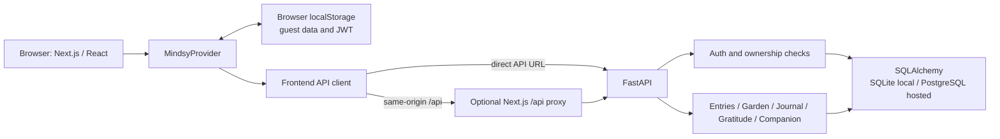
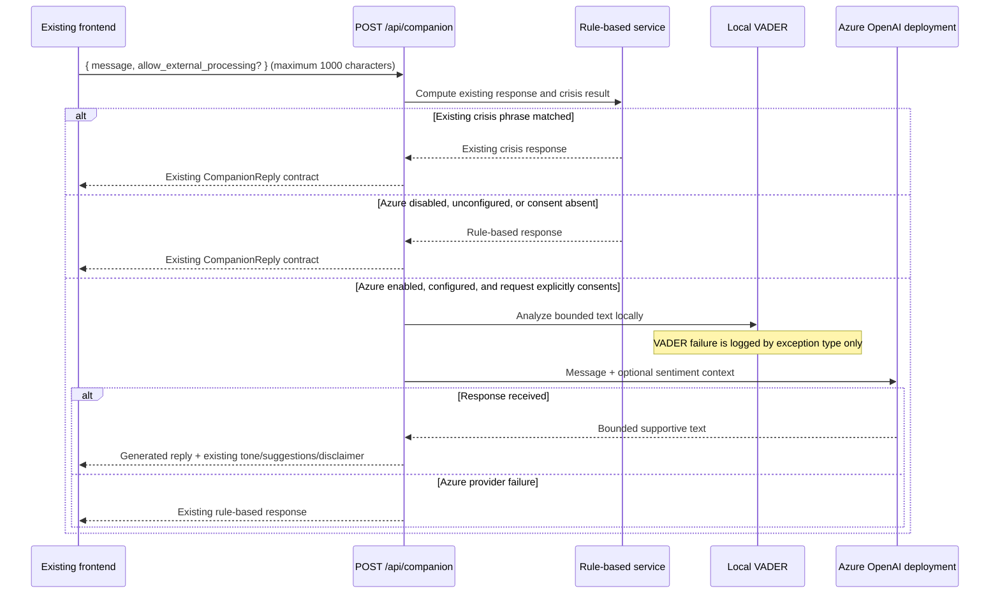

# Mindsy architecture

## Application boundary

The maintained application has a Next.js/React browser client and a FastAPI service. The root
Streamlit prototype (`app.py`, `utils.py`, and root `requirements.txt`) is retained separately and
is not imported by the maintained app.

The frontend can call the API directly (`NEXT_PUBLIC_API_URL`) or use the Next.js `/api/*` rewrite
(`API_PROXY_TARGET`). Direct calls require the API CORS allow-list to include the frontend origin;
the same-origin proxy does not require browser-to-API CORS.

## Persistence and identity

- The API stores users, mood entries, journals, and gratitude notes in SQLAlchemy tables.
- SQLite is the local default. PostgreSQL uses the included `psycopg` driver. Tables are created
  during application startup; startup also applies the targeted nullable VADER-column migration
  for existing `mood_entries` tables. An Alembic migration workflow is not present.
- Authenticated API queries are scoped to the signed-in user. Passwords are bcrypt-hashed and the
  API uses bearer JWTs.
- The frontend stores guest data and the account token in browser `localStorage`. Guest data is
  copied to the account during sign-up/sign-in; guest keys are cleared only after migration
  succeeds. A partially completed migration may need attention before retrying.
- Insights, weather, and the guest garden are derived in the frontend. The backend garden endpoint
  derives account plants from check-ins rather than persisting a second garden record.

## Stable garden derivation

For each check-in, both the frontend and backend implementations hash the ASCII UUID using 32-bit
FNV-1a. The digest determines the plant species/variant, position, depth, and scale. Age determines
seedling, growing, or bloom status. This keeps a check-in's plant stable across refreshes without
storing generated positions.

The paired implementations are `frontend/src/lib/garden.ts` and
`backend/app/services/garden.py`; changes to either algorithm should be checked against the other.

## Companion request path

The crisis check is performed by the existing rule-based service before the route checks Azure
configuration. Crisis-matched input is not analyzed by VADER and is never sent to Azure. The
existing request shape remains valid and opts out; an optional `allow_external_processing` boolean
must be `true` for Azure processing. The response schema is unchanged:

- Request: `{"message": "..."}`; optional consent: `{"allow_external_processing": true}`.
- Response: `reply`, `tone`, `suggestions`, `crisis`, and `disclaimer`.

## Sentiment and Azure boundary

`backend/app/services/sentiment.py` processes at most 1000 characters locally and returns VADER's
compound score and positive/negative/neutral proportions. Longer text is deterministically
truncated to its first 1000 trimmed characters for analysis; the full reflection is retained as
the user's check-in note. Classification uses VADER's established compound thresholds: `>= 0.05`
positive, `<= -0.05` negative, otherwise neutral. Empty input is neutral with zero scores; invalid
types are rejected.

Authenticated check-in creation analyzes a non-empty note locally and stores the four numeric
scores in nullable columns on the same user-owned row. Analysis errors are logged by exception type
only and do not block saving. Existing check-in rows receive `NULL` scores; the response adds
optional `sentiment_positive`, `sentiment_negative`, `sentiment_neutral`, and
`sentiment_compound` fields. Existing selected emotions remain unchanged. Guest entries remain
browser-local until the existing account migration submits them to the API.

At startup, `init_db` performs an idempotent additive schema update that adds only missing nullable
`FLOAT` columns to `mood_entries`, preserving existing records. This is not a general migration
framework; back up production databases and test startup migrations before deployment.

`backend/app/services/azure_openai.py` uses `AsyncAzureOpenAI` from the official OpenAI Python SDK.
The configured Azure deployment name is passed as the chat-completions model; the code does not
assume a deployment is named `gpt-4o`. The prompt requests short, supportive, non-clinical language
and prohibits diagnosis, medication advice, claims of professional status, and dependency-forming
language. Prompt instructions cannot guarantee model behavior and do not replace safety review.

The Azure service is disabled by default. It requires `AZURE_OPENAI_ENABLED=true`, non-empty
endpoint, API key, deployment, and API version, and explicit per-request consent. Otherwise, the
route returns before running VADER. Requests use an eight-second timeout, no automatic SDK retries,
a 180-token output limit, and a 1200-character output bound. Provider exception messages,
credentials, and reflection text are not logged. Errors are reduced to safe categories before the
route falls back to the existing deterministic response.
The operator must select a deployment serving GPT-4o; the code cannot verify the underlying model
without querying Azure.

VADER is local inference. Only when Azure is enabled/configured and a request explicitly consents
are the message and derived sentiment summary sent to the configured Azure endpoint. The current
frontend sends only `message`, so it continues to use the rule-based response even if Azure is
configured. No database or conversation history was added. Azure-side data handling depends on the
configured resource and account policies; this project makes no regulatory-compliance claim. The
current Companion page still describes a rule-based engine and no paid AI provider. Do not enable
the frontend for Azure until a separately approved UI update accurately discloses external
processing and obtains consent.

## Configuration and operating notes

Backend settings are loaded from environment variables and `backend/.env` via `python-dotenv`.
`backend/.env.example` contains placeholders only. The frontend receives no Azure variable or key.
See [DEPLOYMENT.md](DEPLOYMENT.md) for local and hosted configuration.

`GET /api/health` is a liveness response; it does not prove a database or Azure integration is
available. The Companion tests mock the Azure SDK and do not make paid/live requests.

## Boundaries

- Mindsy is a wellness journal, not a diagnosis, treatment, or emergency service.
- The current phrase-based crisis check is useful routing but is not a complete risk detector.
- Account tokens are stored in browser `localStorage`; an injected script could read them.
- No migration tool, account deletion workflow, email verification, or password-reset flow is
  documented as implemented.
- No external production deployment or real Azure inference is claimed.
